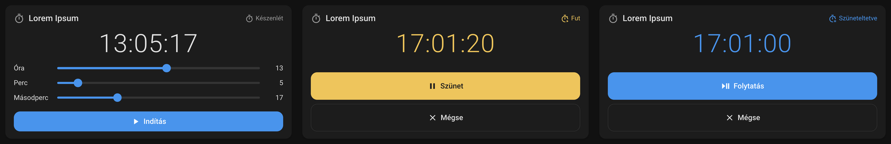
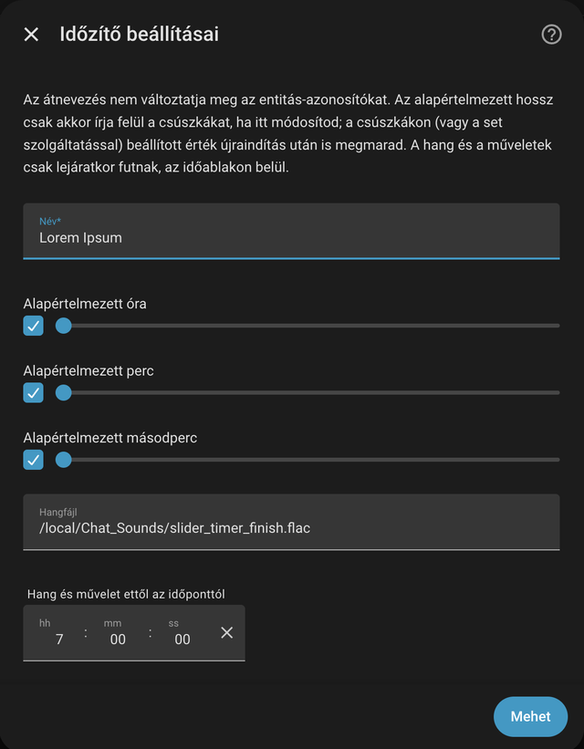
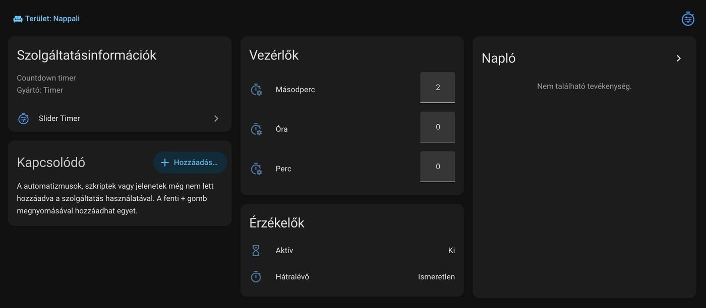

# Slider Timer

[](https://my.home-assistant.io/redirect/hacs_repository/?owner=kleinweiss&repository=slider-timer&category=integration)
[](https://github.com/kleinweiss/slider-timer/actions/workflows/validate.yml)

A compact countdown timer for Home Assistant: a slider dashboard card, a
remaining time that refreshes every second, an expiry sound and expiry actions
that run on the server, and **voice control (Assist)** with English and
Hungarian sentences.

One download installs everything: the integration, the
`custom:slider-timer-card` dashboard card and the expiry sound.

*Requires Home Assistant 2026.5 or newer. License: MIT.*



<sub>The card idle (set the duration with the sliders), running and paused. Shown with the Hungarian interface; the card follows your Home Assistant language.</sub>

## Installation

### Marketplace (HACS)

1. Click the button above, or open **Settings → Marketplace**, choose
   **Custom repositories** from the three-dot menu and add
   `https://github.com/kleinweiss/slider-timer` with the type **Integration**.
2. Download **Slider Timer** and restart Home Assistant.

### Manually

Copy `custom_components/slider_timer` into your configuration directory as
`/config/custom_components/slider_timer/` and restart Home Assistant.

## Setup

1. **Settings → Devices & services → Add integration → Slider Timer.** Give the
   timer a name (it becomes the device name), the default duration and – if you
   want one – the expiry sound (media player, sound file, time window) and the
   expiry actions. Every field can be changed later on the integration's
   **Configure** page. Add as many timers as you like.

   

2. **Add the card** to a dashboard – it shows up in the card picker as
   *Slider Timer Card*, or in YAML:

   ```yaml
   type: custom:slider-timer-card
   ```

   That is all it takes. With several timers, `name:` or `entity:` (the
   remaining-time sensor) selects one; the visual editor lists them.

The integration serves the card at `/slider_timer/slider-timer-card.js` and adds
it as a dashboard resource by itself (`?v=<version>`, so browsers pick up new
versions). There is nothing to copy into `www/`.

> **YAML-mode dashboard resources:** Home Assistant does not let integrations
> change YAML resources. Add this to `lovelace: resources:` instead:
>
> ```yaml
> - url: /slider_timer/slider-timer-card.js?v=1.0.1
>   type: module
> ```

The bundled expiry sound is `/slider_timer/sounds/slider_timer_finish.flac`
(the default *Sound file*); any other media ID, such as `/local/…` or
`media-source://…`, works too.

## What the integration creates

Per timer (the entity IDs follow your installation's language):



| Entity | What it does |
|---|---|
| `sensor.<name>_remaining` | The remaining time in `H:MM:SS`. This is the control entity: the services target it. Attributes: `status` (idle / active / paused), `remaining_seconds`, `duration_seconds`, `ends_at`. When idle, the state is `unknown`. |
| `number.<name>_hours`, `_minutes`, `_seconds` | The default duration – the length `slider_timer.start` uses when you do not give one. |
| `binary_sensor.<name>_active` | On while the timer is running or paused. |

## Services and events

Every service targets the remaining-time sensor:

```yaml
- action: slider_timer.start
  target:
    entity_id: sensor.kitchen_remaining
  data:
    minutes: 10          # optional: hours / minutes / seconds
    media_player: media_player.kitchen   # optional, overrides the setting
    actions:                              # optional, overrides the setting
      - action: light.turn_on
        target:
          entity_id: light.kitchen
```

`slider_timer.pause`, `slider_timer.resume` and `slider_timer.cancel` take no
data; `slider_timer.set` sets the default duration without starting.

Events, following the built-in `timer` integration: `slider_timer_started`,
`slider_timer_paused`, `slider_timer_resumed`, `slider_timer_cancelled`,
`slider_timer_finished`.

The expiry sound and actions run on the server, so the dashboard may be closed
when the timer expires. Outside the configured time window neither runs; if the
window's start equals its end, there is no time limit. A timer that expired
while Home Assistant was down returns idle without playing the sound.

## Voice control (Assist)

The integration registers its own intents, with Hungarian and English sentences
(it copies `sentences/<language>/slider_timer.yaml` into
`/config/custom_sentences/<language>/` by itself, and never overwrites an
existing file).

| What you say (example) | What it does |
|---|---|
| „Indítsd el a konyhai időzítőt 10 percre" *(start the kitchen timer for 10 minutes)* | Start with the given duration |
| „Indítsd el az időzítőt" *(start the timer)* | Start with the value of the hour / minute / second entities |
| „Szüneteltesd az időzítőt" *(pause the timer)* | Pause |
| „Folytasd az időzítőt" *(resume the timer)* | Resume |
| „Állítsd le az időzítőt" / „Töröld az időzítőt" *(stop / delete the timer)* | Cancel |
| „Mennyi van még hátra?" *(how much is left?)* | The remaining time |

## Upgrading from the betas (integration 1.0.0-beta / card 3.0.x)

* The card now comes with the integration. The hand-added
  `/local/slider-timer-card/slider-timer-card.js` resource is switched over to
  the bundled copy automatically; afterwards you can delete
  `/config/www/slider-timer-card/`.
* The entity keys became English. Existing timers are migrated on the first
  start: your entity IDs, names and history stay exactly as they were.
* A timer that used the old default sound
  (`/local/Chat_Sounds/slider_timer_finish.flac`) is switched to the bundled
  one.

## Development

```bash
pip install pytest-homeassistant-custom-component
pytest
```

The **Validate** workflow runs the Marketplace (HACS) check, hassfest and the
tests on every push.
